# Отчёт по лабораторной работе №2 (Node-RED)

**ФИО:** Горбунов Кирилл  
**Группа:** УИР-241

## Способ установки

Node-RED установлен через npm (без Docker).

- Node.js: v24.21.0
- Node-RED: v5.0.8

## Освоенные ноды

inject, debug, function, switch, change, template, http request, mqtt in/out, http in/response, ui_gauge, ui_chart, telegram receiver/sender/command, file in/out, flow context.

## Использованные AI-промпты

1. «Сгенерируй JS-код для function node с let/const, if/else, циклом for, массивом и объектом»
2. «Составь Mustache-шаблон для JSON с полями name, lab, group»
3. «Настрой MQTT flow с публичным брокером broker.hivemq.com»

## Скриншоты

### 1. Версии Node.js и npm

### 2. Версии Node-RED и Node.js

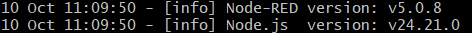

### 3. Inject → Debug

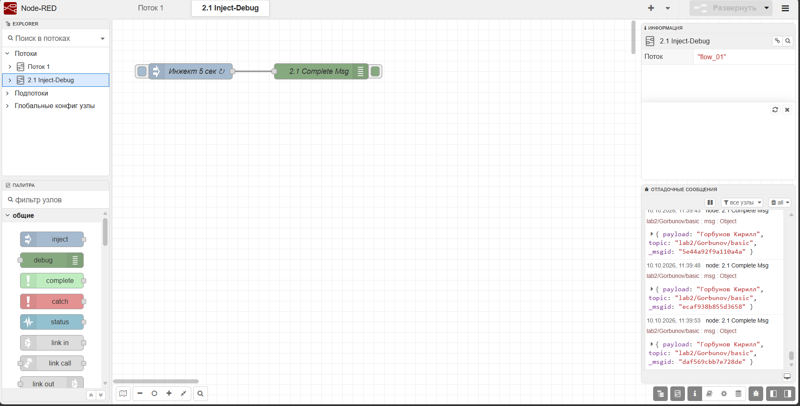

### 4. Function node

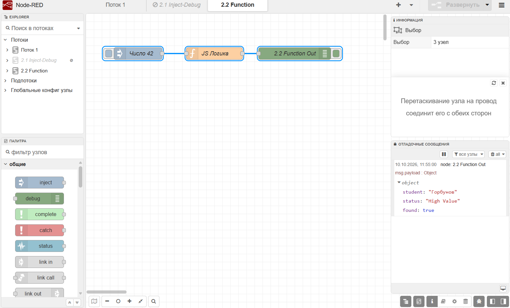

### 5. Switch node

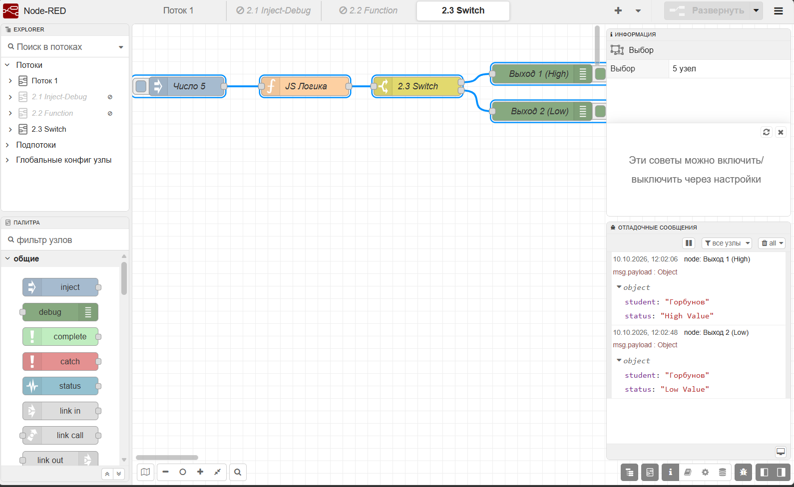

### 6. Change node

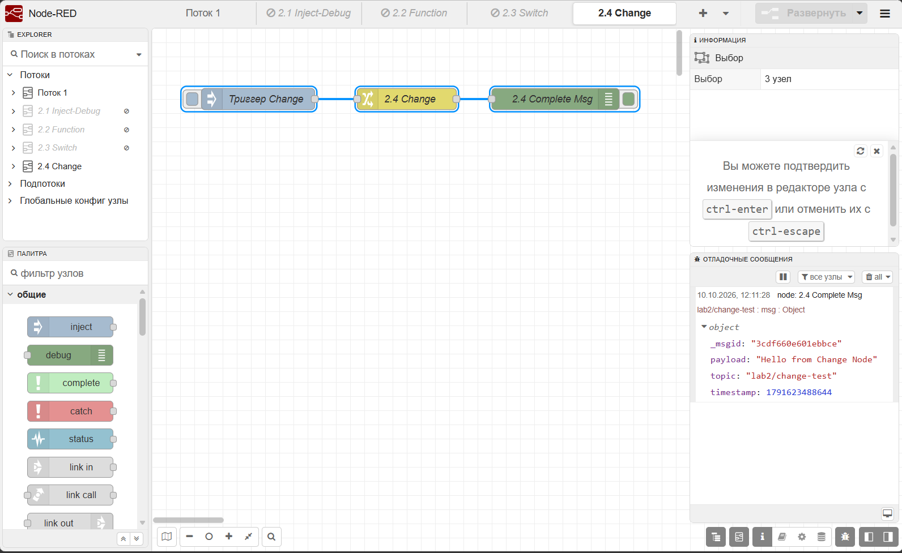

### 7. Template node

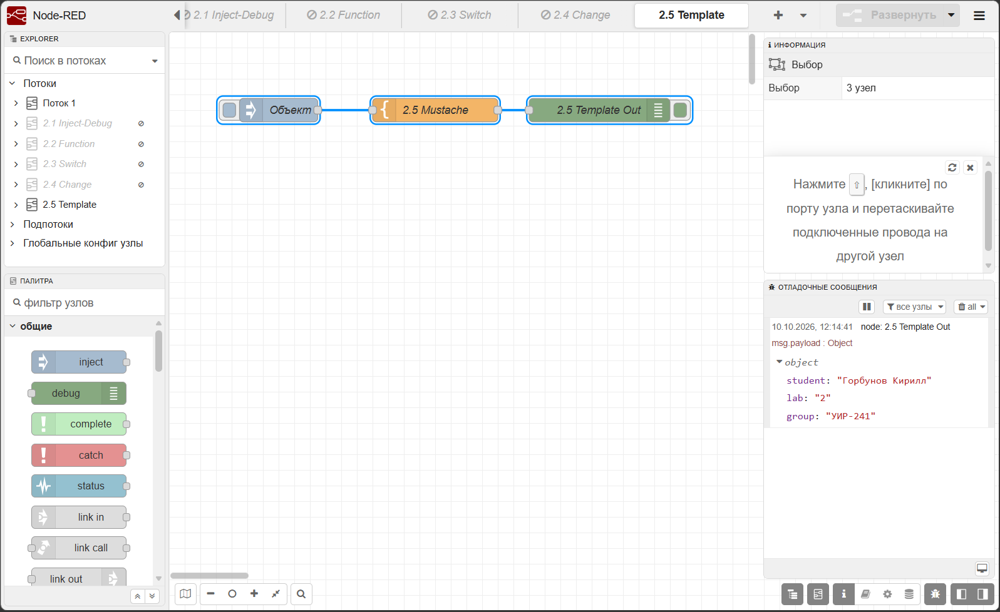

### 8. HTTP Request

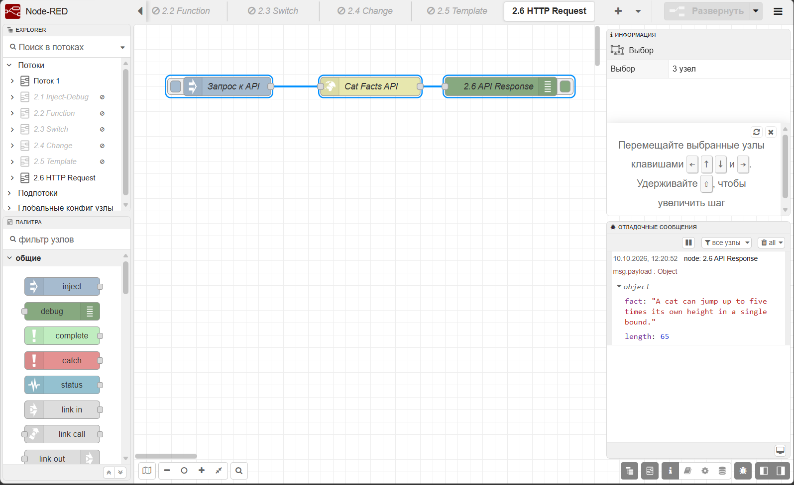

### 9. MQTT

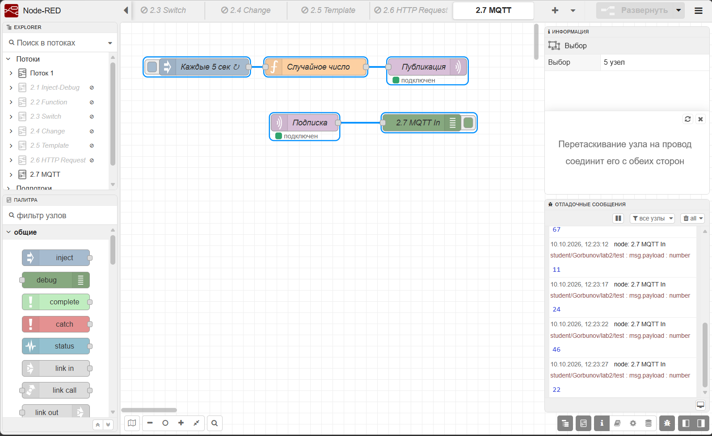

### 10. GET-эндпоинты

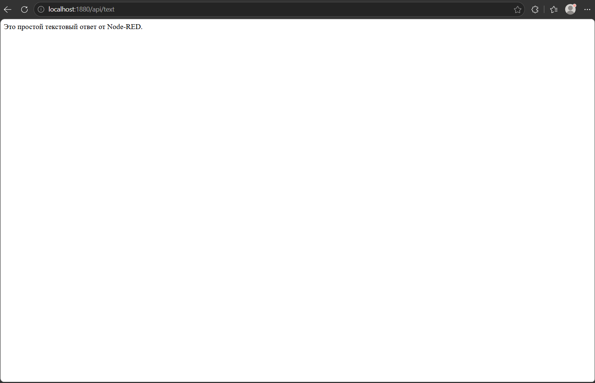
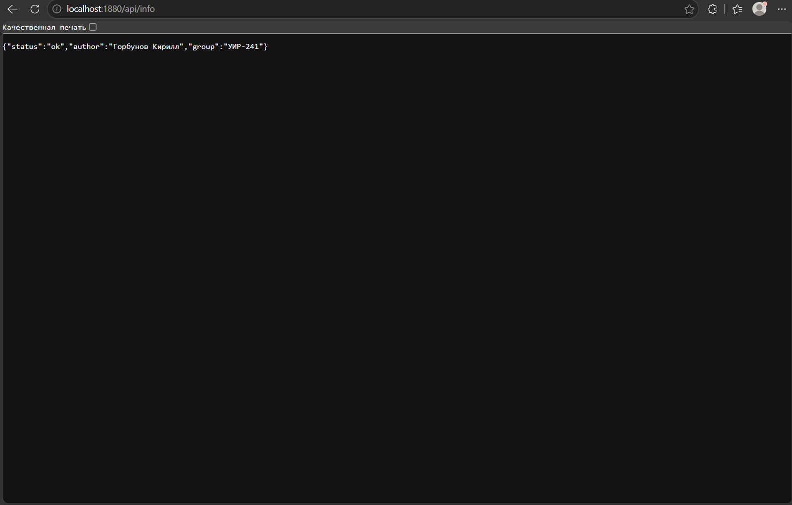
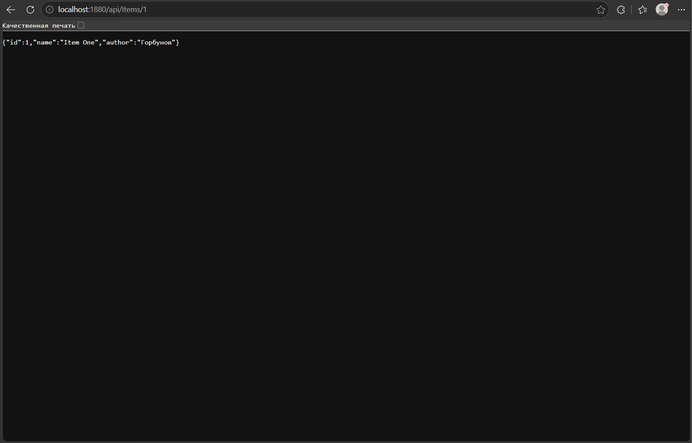
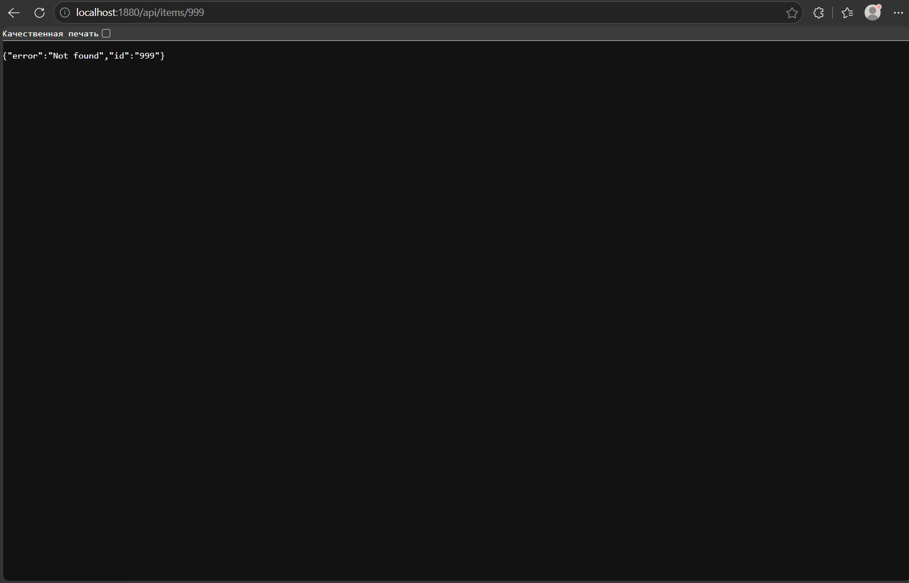

### 11. Dashboard

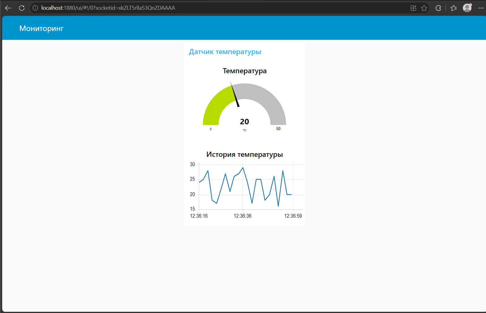

### 12. Telegram-бот

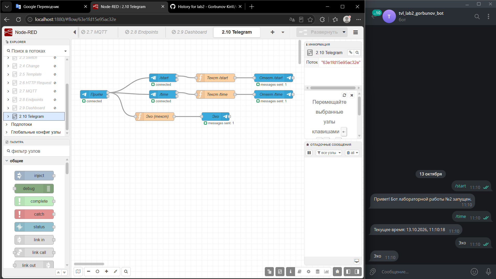

### 13. Файлы

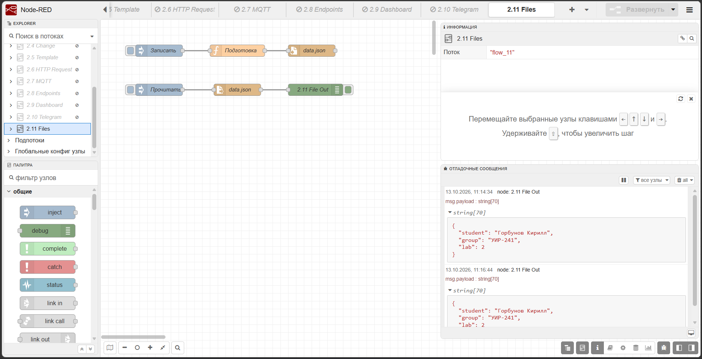

### 14. Контекст

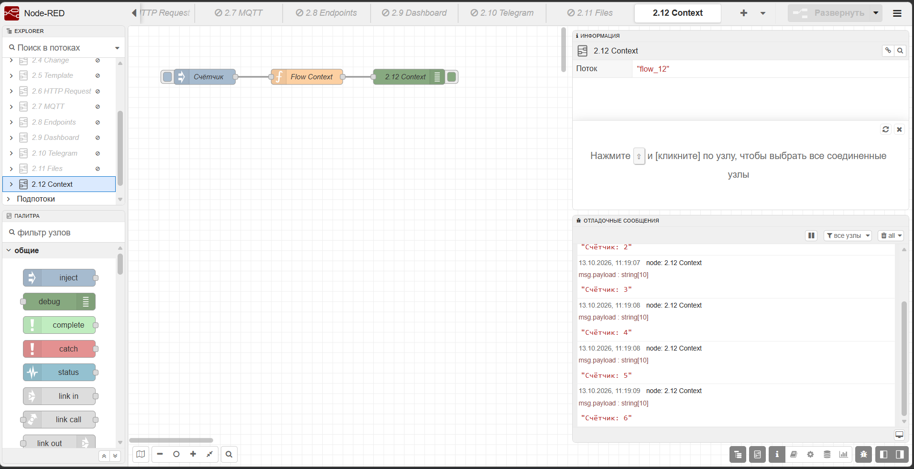

## Выводы

В ходе работы я освоил Node-RED как low-code инструмент. Научился собирать потоки из готовых нод, работать с function-нодами (JavaScript), настраивать HTTP-эндпоинты, MQTT, Telegram-бота и dashboard. Понял, как работает контекст (flow context) для хранения состояния между сообщениями. Установка через npm дала больше контроля над версиями, чем Docker.