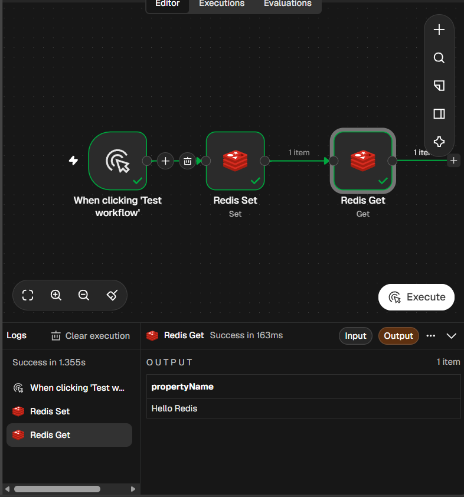
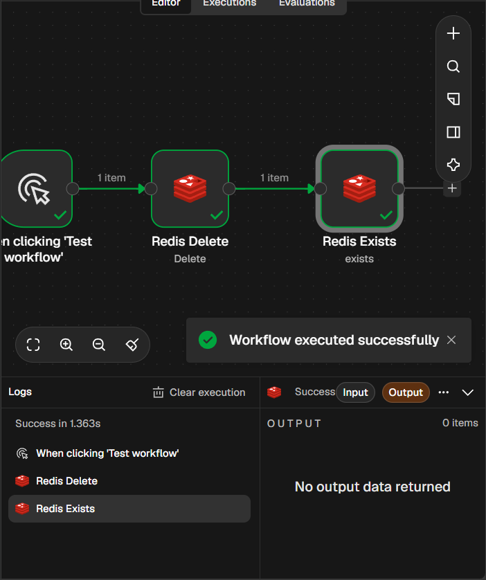

# Redis в n8n

## Установка Redis
docker run -d --name redis -p 6379:6379 redis:7

## Настройка Credentials
Host: host.docker.internal
Port: 6379

## Workflow 1: Создание и чтение ключа
Ключ: gorbunov
Значение: Hello Redis

## Workflow 2: Удаление и проверка
Ключ: gorbunov
После удаления проверка Exists возвращает false.

