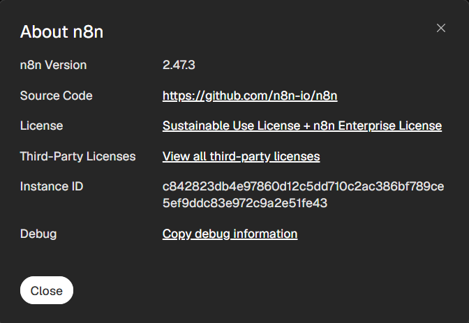
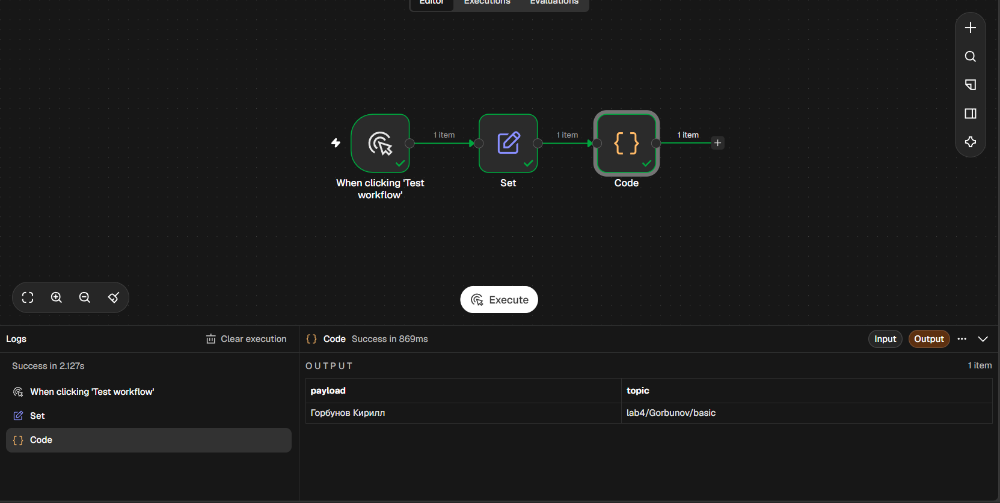
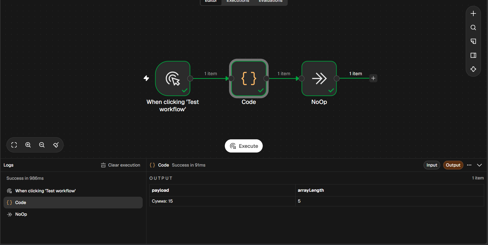
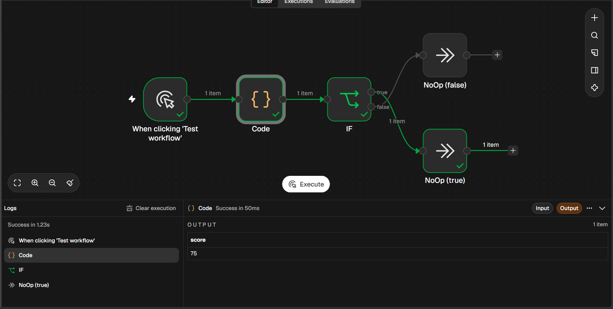
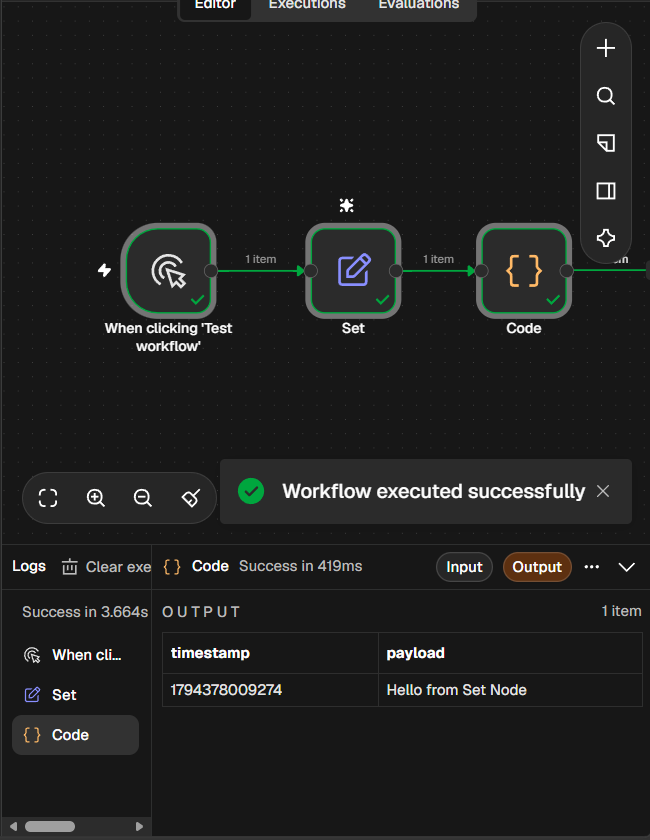
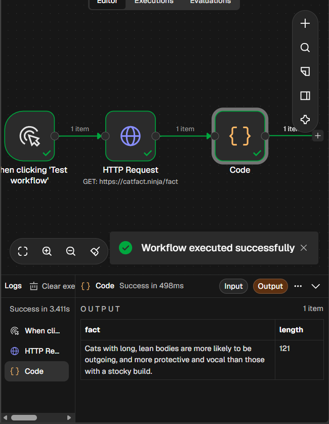
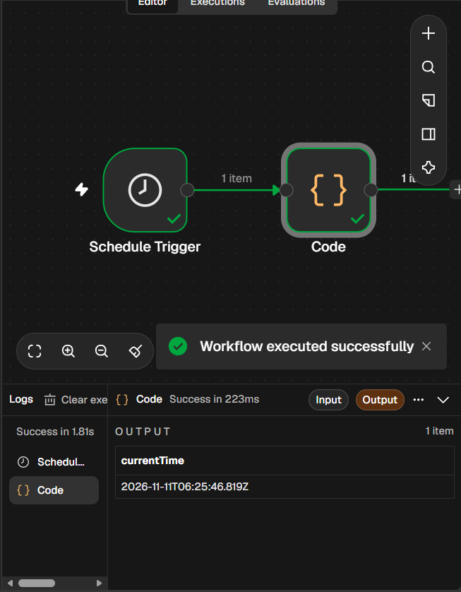
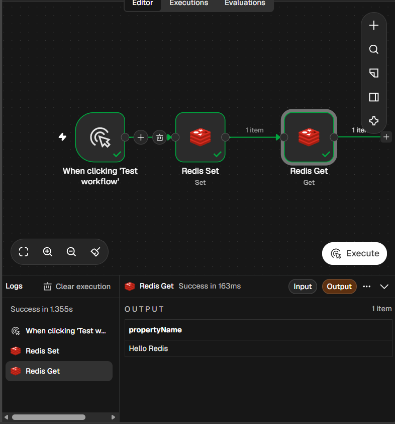
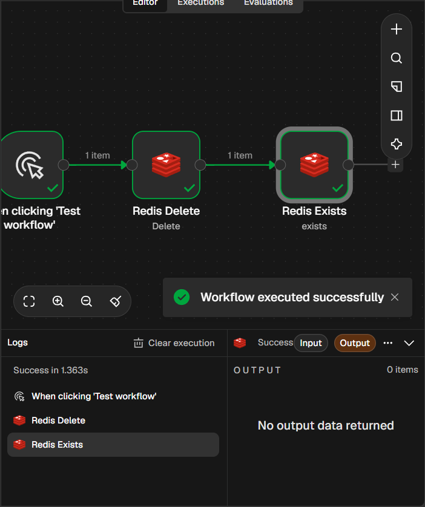

# Отчёт по лабораторной работе №4 (n8n)

**ФИО:** Горбунов Кирилл
**Группа:** УИР-241

## 1. Краткое описание
Установлен n8n через Docker. Созданы 6 базовых workflow, настроен Redis и выполнены операции создания, чтения и удаления ключа.

## 2. Использованные AI-промпты
- «Сгенерируй workflow n8n с Manual Trigger, Set и Code node»
- «Настрой Redis credentials для n8n в Docker»
- «Создай workflow для HTTP Request к catfact.ninja»

## 3. Освоенные ноды
Manual Trigger, Set, Code, NoOp, IF, HTTP Request, Schedule Trigger, Redis.

## 4. Скриншоты

### Версия n8n

### 2.1 Manual Set

### 2.2 Code

### 2.3 IF

### 2.4 Set

### 2.5 HTTP Request

### 2.6 Schedule

### Redis Set

### Redis Delete

## 5. Выводы
В ходе работы освоена платформа n8n как low-code инструмент автоматизации. Настроено взаимодействие с Redis, выполнены базовые и продвинутые сценарии. Установка через Docker обеспечивает изоляцию и удобство развёртывания.