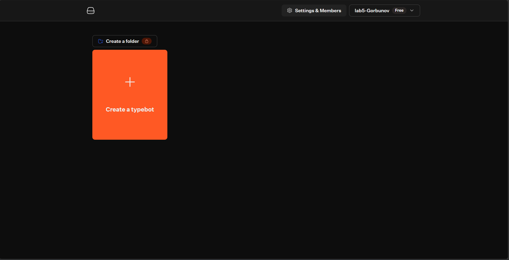
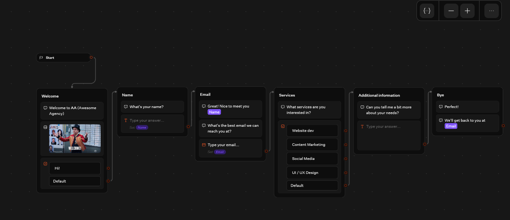
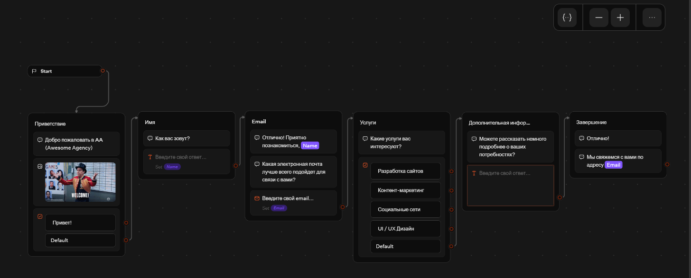
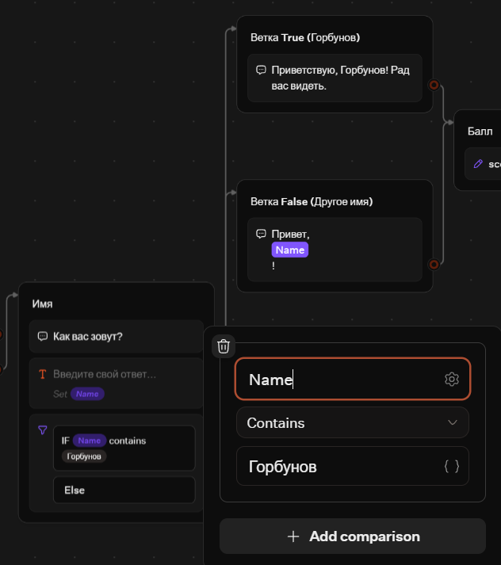
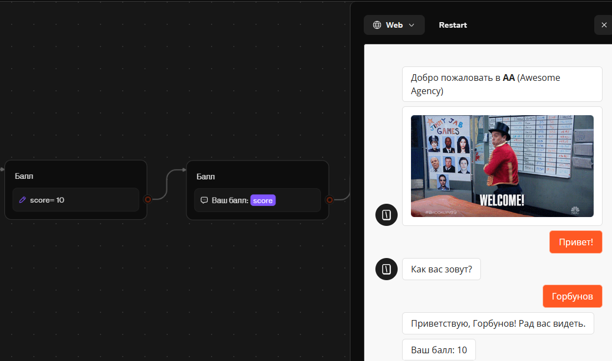
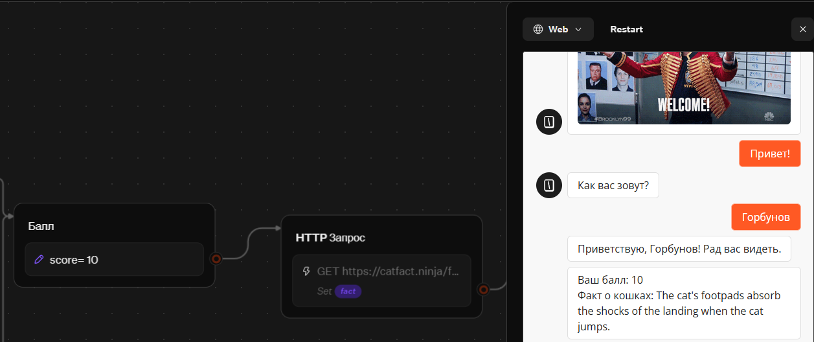
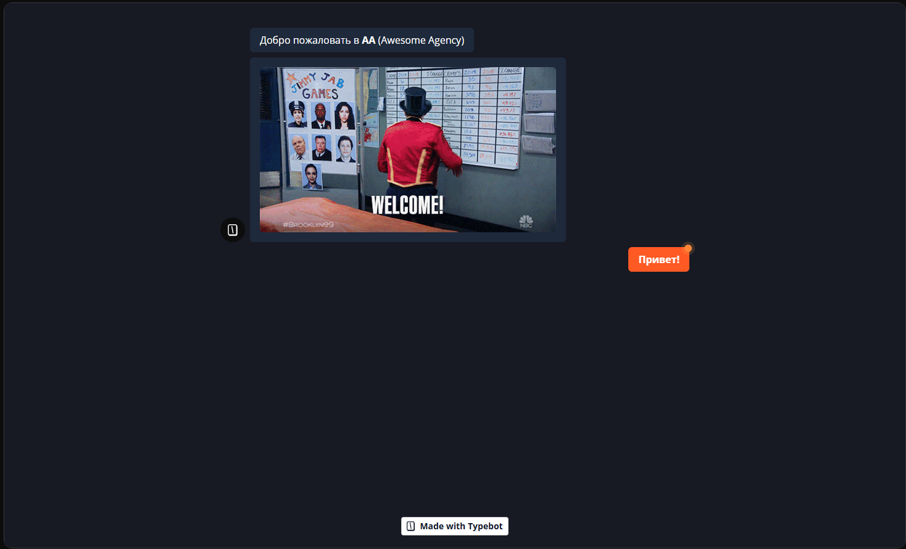
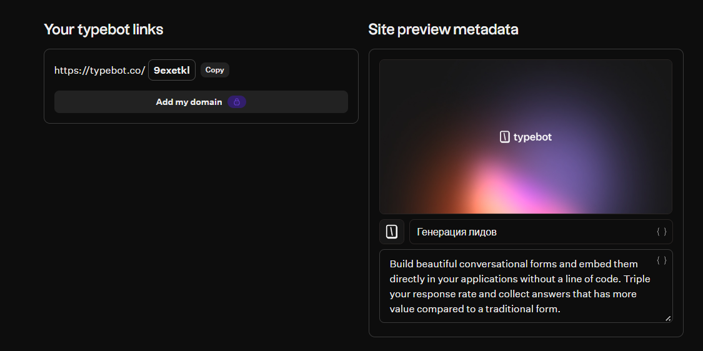

# Отчёт по лабораторной работе №5 (TypeBot)

**ФИО:** Горбунов Кирилл
**Группа:** УИР-241

## 1. Краткое описание
Выбран трек C (TypeBot). Создан workspace `lab5-Gorbunov`, выбран шаблон Lead Generation и русифицирован. Добавлены новые блоки, условие, переменные, HTTP Request и изменён брендинг. Бот опубликован по веб-ссылке и экспортирован в JSON.

## 2. Ссылка на бота
https://typebot.co/9exetkl

## 3. Использованные AI-промпты
- «Переведи все тексты в шаблоне на русский, сохранив переменные»
- «Сгенерируй условие для проверки имени»
- «Настрой HTTP Request к catfact.ninja»

## 4. Освоенные блоки и элементы
- Text, Input, Condition, Set variable, HTTP Request, Theme.
- Переменные, условия, интеграции, публикация.

## 5. Скриншоты

### Регистрация

### До перевода

### После перевода

### Условие

### Переменные

### HTTP Request

### Тема

### Публикация

## 6. Выводы
В ходе работы освоена платформа TypeBot как инструмент для создания чат-ботов. На практике применены русификация шаблона, добавление логики (условия, переменные), интеграция с внешним API и настройка брендинга. Бот опубликован и экспортирован.