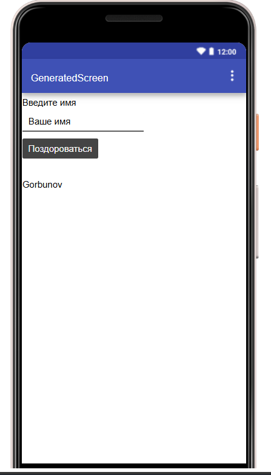
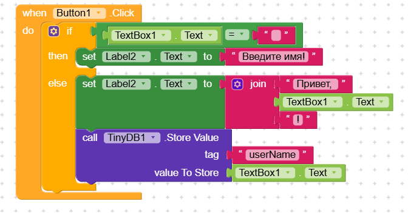
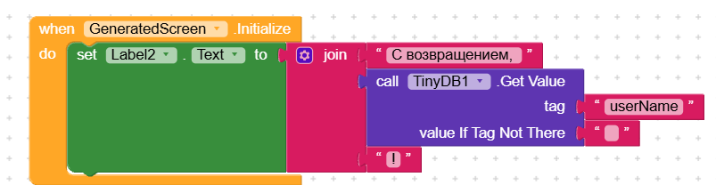

# Отчёт по лабораторной работе №6 (Kodular)

**ФИО:** Горбунов Кирилл
**Группа:** УИР-241

## 1. Краткое описание
Создано приложение «Приветствие» на платформе Kodular. Реализована базовая логика: проверка пустого поля ввода и вывод приветствия. Выполнена ачивка 1: сохранение имени в TinyDB для автоматического приветствия при следующем запуске.

## 2. Ссылка на проект или файл .aia
[вставьте ссылку] или `exports/lab6-Gorbunov.aia`

## 3. Использованные AI-промпты
- «Как в Kodular сделать проверку пустого TextBox и вывод сообщения?»
- «Как использовать TinyDB для сохранения имени и загрузки при старте?»
- «Как экспортировать проект в .aia?»

## 4. Освоенные компоненты и блоки
- Компоненты: Label, TextBox, Button, TinyDB.
- Блоки: when Button.Click, if then else, join, set Label.Text, call TinyDB.StoreValue, call TinyDB.GetValue, when Screen.Initialize.

## 5. Скриншоты

### Экран дизайнера

### Блоки базовой логики

### Ачивка 1: TinyDB

## 6. Ограничения бесплатного тарифа
- До 10 проектов.
- До 10 МБ ассетов.
- До 5 расширений.
- Брендинг Kodular в приложении.

## 7. Выводы
В ходе работы освоена платформа Kodular для создания Android-приложений. На практике применены визуальные компоненты и блочная логика, реализовано сохранение данных через TinyDB. Тестирование на реальном устройстве через Kodular Companion подтвердило работоспособность приложения.